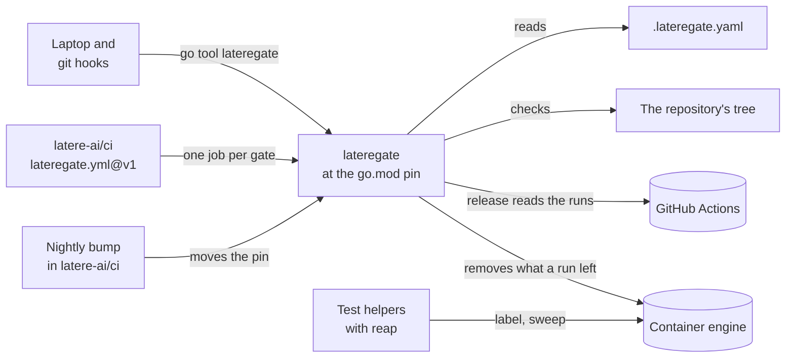

# ci-gate

**ci-gate is the quality bar Latere's Go repositories run on every push:
one binary, `lateregate`, that a repository pins in `go.mod` and runs with
no arguments.** It decides which gates apply by reading the tree, runs all
of them, and reports every failure in one pass. The same binary runs in
the pre-commit and pre-push hooks, on a laptop, and in CI, so a gate
cannot pass in one place and fail in another.

[](https://github.com/latere-ai/ci-gate/actions/workflows/ci.yml)
[](https://github.com/latere-ai/ci-gate/releases)
[](go.mod)
[](LICENSE)

This repository owns what each gate asserts.
[`latere-ai/ci`](https://github.com/latere-ai/ci) owns the GitHub Actions
workflows that run the binary on a runner and cut releases. The two
version independently: a repository takes new gates by moving its
`go.mod` pin, and a new pipeline when the `@v1` tag it calls moves.

## Status

`lateregate` is before v1.0.0, and any release can change what a gate
reports. The section of each release in the [changelog](CHANGELOG.md)
says what changed for a repository that runs the bar, and the
[releases page](https://github.com/latere-ai/ci-gate/releases) lists the
releases. Twenty-nine repositories of Latere run it: 21 public ones,
whose pin a nightly workflow moves to each release once the whole bar
passes on it, and 8 private ones, moved from a workstation. The tool has
had no external security audit; [`SECURITY.md`](SECURITY.md#what-is-protected)
says what it protects and the test that checks each property.

| Part | State |
|---|---|
| The gates in [the bar](#the-bar) | Work. CI runs them on Linux, and the maintainers also run them on macOS. Not tested on Windows |
| `init`, `contract` and the two git hooks | Work in a git repository |
| `release`, `release-notes` and the guard that reads CI before a cut | Work with GitHub and GitHub Actions only |
| `build`, `push`, `deploy` and `deploy-credential`, for a repository that releases from a workstation | Work with Podman or Docker, a container registry, a Kubernetes cluster, and a rollout credential kept in 1Password |
| `reap`, the one package other modules import | Works with Docker and with Podman, through the engine's Unix socket |
| `identity`, `platform-via-sdk` and `words` | Hold Latere's own rules: the identity shape, the platform's routes, and the organization's do-not-use words. Every repository declares an identity role, and the role `none` holds nothing; the other two run only where a repository turns them on |
| `lateregate identity family`, the check across repositories | Works; adding it to every repository is not finished |

## Quickstart

You need Go and git. From an empty directory, this makes a small module
and runs the bar on it:

```sh
mkdir hello && cd hello
git init -q
go mod init example.com/hello

cat > hello.go <<'GO'
package hello

// Greet returns a greeting for name.
func Greet(name string) string { return "hello, " + name }
GO
cat > hello_test.go <<'GO'
package hello

import "testing"

func TestGreet(t *testing.T) {
	if got := Greet("x"); got != "hello, x" {
		t.Fatalf("got %q", got)
	}
}
GO

go get -tool latere.ai/x/ci-gate/cmd/lateregate@latest
go mod tidy

cat > .lateregate.yaml <<'YAML'
identity:
  role: none
license:
  spdx: MIT
  holder: Your Name
YAML
cat > LICENSE <<'TXT'
MIT License

Copyright (c) 2026 Your Name

Permission is hereby granted, free of charge, to any person obtaining a copy
of this software and associated documentation files (the "Software"), to deal
in the Software without restriction, including without limitation the rights
to use, copy, modify, merge, publish, distribute, sublicense, and/or sell
copies of the Software, and to permit persons to whom the Software is
furnished to do so, subject to the following conditions:

The above copyright notice and this permission notice shall be included in all
copies or substantial portions of the Software.

THE SOFTWARE IS PROVIDED "AS IS", WITHOUT WARRANTY OF ANY KIND, EXPRESS OR
IMPLIED, INCLUDING BUT NOT LIMITED TO THE WARRANTIES OF MERCHANTABILITY,
FITNESS FOR A PARTICULAR PURPOSE AND NONINFRINGEMENT. IN NO EVENT SHALL THE
AUTHORS OR COPYRIGHT HOLDERS BE LIABLE FOR ANY CLAIM, DAMAGES OR OTHER
LIABILITY, WHETHER IN AN ACTION OF CONTRACT, TORT OR OTHERWISE, ARISING FROM,
OUT OF OR IN CONNECTION WITH THE SOFTWARE OR THE USE OR OTHER DEALINGS IN THE
SOFTWARE.
TXT

git add -A
go tool lateregate license -w
go tool lateregate
```

The first run downloads golangci-lint and govulncheck through the Go
module proxy at the versions the binary pins, so it takes a minute or
two. The bar's verdicts come last:

```text
PASS fmt-check
PASS modernize
PASS cgo-free
PASS otel-client
PASS license
PASS identity
PASS postgres
PASS tidy
PASS lint
PASS vuln
PASS suite
11 gates passed
```

The gates read what git tracks, so a file joins the bar once it is
added. `license -w` writes the SPDX notice on every tracked file that
lacks it, and the `license` gate then checks that each notice matches the
declaration and the root `LICENSE`.

### In an existing repository

In a git repository with a Go module:

```sh
go get -tool latere.ai/x/ci-gate/cmd/lateregate
go tool lateregate init
```

`init` writes the wiring the bar expects, where it is missing: the CI
caller at `.github/workflows/ci.yml`, the two git hooks under
`.githooks/` (and `core.hooksPath`, when it is unset), two lines in
`.gitignore`, and a `CHANGELOG.md` with an `## Unreleased` heading. It
never overwrites a workflow, a changelog or a pre-push hook that exists,
leaves a `core.hooksPath` set elsewhere and prints the command to change
it, and never touches `Makefile` or `.lateregate.yaml`. Write the two
decisions the tool cannot make for you in `.lateregate.yaml`, as in the
quickstart: the identity role (`none` for a library or a tool) and the
license. Then stamp the notice, check the wiring, and run the bar:

```sh
go tool lateregate license -w   # writes the SPDX notice where it is missing
go tool lateregate contract     # "in shape", or every drift named
go tool lateregate              # the whole bar
```

Commit the result. A release workflow is a separate caller, chosen by what
the repository ships; the [ci README](https://github.com/latere-ai/ci#readme)
lists them.

## The bar

`lateregate` with no arguments runs every gate that applies, does not
stop at the first failure, and puts the summary last.

On a laptop it checks what changed since the default branch, which CI has
already held to the whole bar: the test suite and lint read the changed
packages and the packages that import them, the coverage floor holds the
packages the change reaches without touching to what they had at the
base, and the vulnerability scan runs only when a Go package changed. A
change to a frontend or a document checks in seconds. A dependency or
configuration change, a removed package, or `-all` checks the whole tree,
and CI and `release` always do;
[`docs/commands.md`](docs/commands.md#what-a-check-reads) has the rule.
A failing run ends like this:

```text
PASS fmt-check
PASS modernize
SKIP spec-lint    tracks no specs/ files
FAIL suite        the suite's coverage is under the floor: below 90%: internal/store 71.2%, ...
FOLD test         into suite
FOLD race         into suite
FOLD hermetic     into suite
FOLD tempdir      into suite
FOLD containers   into suite
FOLD cover        into suite
lateregate: 1 of 13 gates failed: suite
```

| Gate | What it asserts |
| --- | --- |
| `fmt-check` | no tracked Go source is unformatted |
| `modernize` | no code that a standard library call already covers |
| `cgo-free` | no Go file imports `"C"` |
| `otel-client` | no outbound HTTP client is built without a tracing transport |
| `container-labels` | every package that imports testcontainers-go imports `reap`, which labels its containers |
| `license` | every source file carries the declared SPDX notice |
| `spec-lint` | the spec tree agrees with itself and with its index |
| `depcheck` | no build reaches a dependency nobody admitted |
| `registers` | no developer sentence in a string handed to a user-facing function |
| `platform-via-sdk` | no platform route outside the Go SDK, `latere.ai/x/sdk-go` |
| `words` | no word on the organization's do-not-use list, which the binary carries, in what a model or a person reads |
| `identity` | the repository holds the rules of the identity role it declares |
| `postgres` | the repository holds the Postgres connection role it declares |
| `enum-go`, `enum-typescript` | declared enum domains use named members and exhaustive switches |
| `tidy` | `go mod tidy` would change no tracked module |
| `actionlint` | actionlint at a pinned version finds nothing in the workflows |
| `action-pins` | every third-party action is the organization's one commit |
| `manifests` | every kustomization renders with kustomize at a pinned version |
| `rules` | every PrometheusRule passes promtool at a pinned version |
| `frontend` | every named Bun package installs from its lockfile, then typechecks, tests and builds |
| `image` | every named container image builds, stays under its size cap, holds no shell, and starts read-only |
| `lean` | every Lake project the repository tracks builds with no warning, so no proof uses `sorry` |
| `lint` | golangci-lint at a pinned version, against a shared config rendered on every run |
| `vuln` | govulncheck at a pinned version finds no reachable vulnerability |
| `suite` | `go vet`, then one run of the test suite that is race-clean, over a per-package coverage floor, leaves nothing under `TMPDIR` and no container behind, and needs only the Go toolchain on `PATH` |
| `e2e` | every named end-to-end suite passes against the Postgres, MinIO and tools `lateregate` starts, and no test in it skips |

A gate applies only when the tree holds what it checks, and one that does
not apply is skipped with the reason: the Go gates need a tracked Go
file, `spec-lint` a `specs/` directory, `depcheck`, `registers`, `words`
and the enum gates a key naming what to check. `test`, `race`,
`hermetic`, `tempdir`, `containers` and `cover` are the six properties
`suite` checks in one run, and each still runs by name for isolating one
of them. [`docs/gates.md`](docs/gates.md) is the reference: what each gate
checks, when it applies, how it fails, and how to configure it.

`go tool lateregate list` prints the plan without running it, and `go
tool lateregate <gate>` runs one gate.

## Containers a test starts

A test helper that starts a container labels it and sweeps before it
starts one, with the `reap` package this module ships:

```go
import "latere.ai/x/ci-gate/reap"

_, _ = reap.Sweep(ctx) // what an exited test binary left, on this machine
ctr, err := postgres.Run(ctx, image, testcontainers.WithLabels(reap.Labels()))
if err != nil && ctr != nil {
	_ = ctr.Terminate(ctx) // a failed start still made a container
}
```

A network the helper makes takes the same labels, through
`network.WithLabels(reap.Labels())`. The labels name the process that owns
the container and the `lateregate` run it belongs to. `suite` sweeps before it runs and, after `go test`
exits, removes and fails on every container the run left. Between them a
container is removed when its test binary panics, is killed, or has no
`TestMain`, on engines where testcontainers' own reaper cannot run, such
as Podman. A container without the labels is invisible to both, so
`container-labels` fails a package that imports testcontainers-go and not
`reap`. [`docs/gates.md`](docs/gates.md#containers-tests-that-fill-the-engine)
has the details.

## Waivers and configuration

A gate that applies runs unless the repository has written down that it
is behind, and until when:

```yaml
waive:
  cover:
    reason: the tree is at 82.2% and the gap is in handler and runner
    until: 2026-11-15
```

Both fields are mandatory. After the date the gate runs and fails on its
own terms.

Everything else in `.lateregate.yaml` is a decision with its reason:
a coverage exemption, a spec vocabulary, a dependency allowlist. The tool
decides every other value by default, rejects unknown keys, and reports a
key that restates its default. [`docs/configuration.md`](docs/configuration.md)
is the full reference.

## In CI

`init` writes the caller. It is the whole CI configuration for the bar:

```yaml
jobs:
  gate:
    uses: latere-ai/ci/.github/workflows/lateregate.yml@v1
```

The reusable workflow asks the binary for its plan (`lateregate list
-json`) and runs one job per gate that runs, so a repository never lists
its gates in YAML. Its inputs and runner options are in the
[ci README](https://github.com/latere-ai/ci#readme).

## How it fits



- **`lateregate`** is built from this repository and run through the
  `go.mod` pin, so the laptop, the hooks and CI run the same version.
- **`.lateregate.yaml`** holds the decisions the tool cannot make for a
  repository, each with its reason. Every other value is a default the
  binary carries.
- **`latere-ai/ci`** holds the workflows: the one that runs the bar on a
  runner, one job per gate, and the release pipelines.
- **The nightly bump** in `latere-ai/ci` moves a public repository's pin
  to each new release once the whole bar passes on it, and opens an issue
  where it does not.
- **`reap`** is the one package other modules import: a test helper uses
  it to label each container it starts, so the suite can remove what a
  run left.

## Documentation

| | |
|---|---|
| [Gates](docs/gates.md) | every gate: what it asserts, when it applies, how it fails, its keys |
| [Commands](docs/commands.md) | every subcommand and flag, the wiring `contract` checks, and the two hooks |
| [Configuration](docs/configuration.md) | `.lateregate.yaml`: defaults, waivers, and every key |
| [Releasing](docs/releasing.md) | the changelog rule, `lateregate release`, stamps, and the CI guard before a cut |

## Contributing

Issues and pull requests are welcome. [`CONTRIBUTING.md`](CONTRIBUTING.md)
covers building and testing a change and how a gate is designed, and
[`specs/`](specs/README.md) holds the reasoning behind each gate. Do not
report a vulnerability in an issue; [`SECURITY.md`](SECURITY.md) says
where to send it.

## License

[MIT](LICENSE)
